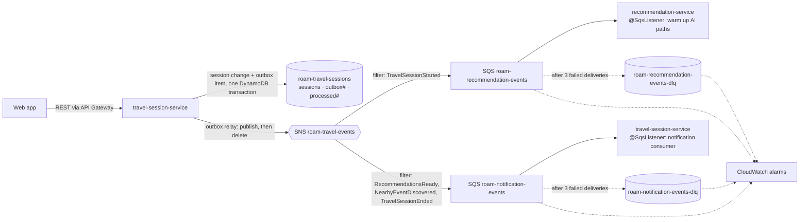

# Event-driven messaging (SNS + SQS)

Travel events let services react to what happens in a travel session without slowing down or depending on the
REST API. Everything here is **off by default** (`TRAVEL_MESSAGING_ENABLED=false`): with it off, no outbox items are
written, nothing is published or consumed, and every API behaves exactly as before.

## Architecture



Interactive APIs (recommendations, chat, place details, routes) stay synchronous. Messaging only carries things nobody
is waiting on.

## Event flows

| Event | Produced when | Consumed by | What the consumer does |
|---|---|---|---|
| `TravelSessionStarted` | `POST /api/v1/travel-sessions` succeeds | recommendation-service | Warms up the AI code paths (Spring AI structured-output schemas) before the first recommendation or chat request. Local only, no OpenAI call. At most once per 30 minutes per task. |
| `RecommendationsReady` | A refresh records new places | travel-session (notifications) | Logs and counts "would notify". There is no push channel yet; Web Push plugs in here. |
| `NearbyEventDiscovered` | A refresh finds new live events | travel-session (notifications) | Same as above. |
| `TravelSessionEnded` | A session is stopped, or first seen as expired | travel-session (notifications) | Logs and counts. |
| `ItineraryUpdated` | **Not produced yet**: itineraries are stored in the browser | — | Contract only, ready for itinerary sync. |

## Event contract

Every message body (SNS raw delivery, so the SQS body is the envelope itself):

```json
{
  "eventId": "6f1c…-uuid",
  "eventType": "RecommendationsReady",
  "eventVersion": 1,
  "timestamp": "2026-10-19T12:00:00Z",
  "correlationId": "the X-Request-Id of the HTTP request that caused it",
  "payload": { }
}
```

The SNS message attribute `eventType` carries the same type, for subscription filtering.

| Event (v1) | Payload |
|---|---|
| `TravelSessionStarted` | `sessionId`, `ownerRef` (SHA-256 prefix of the Okta subject, never the identity), `interests`, `currencyCode`, `availableMinutes` |
| `TravelSessionEnded` | `sessionId`, `reason` (`STOPPED` or `EXPIRED`) |
| `RecommendationsReady` | `sessionId`, `placeIds`, `source` (`refresh`) |
| `NearbyEventDiscovered` | `sessionId`, `events[]`: `eventId`, `name`, `type`, `venueName`, `startsAt`, `headline` |
| `ItineraryUpdated` | `itineraryId`, `cityId`, `dayCount`, `stopCount` |

**Privacy:** no payload carries coordinates, venue coordinates, or raw user identifiers.

**Compatibility:** consumers ignore unknown fields. A breaking payload change gets a new `eventVersion`.

## Reliability

- **Transactional outbox.** An event goes into the session table as `outbox#<eventId>`, in the same DynamoDB
  `TransactWriteItems` as the session change: both are written or neither is.
  - After the commit it is published at once and deleted.
  - A sweep every 30 s (`TRAVEL_MESSAGING_RELAY_INTERVAL_MS`) publishes anything older than 20 s that is still there,
    which covers a crash or an SNS outage.
  - Unpublished items expire after 7 days (TTL).
  - `NearbyEventDiscovered` has no session write, so its outbox item is written on its own.
- **Never breaks the API.** SNS errors are logged and counted; the event waits for the sweep.
- **SQS problems never stop a service from starting.** Listener containers are created with `autoStartup` off.
  `SqsListenerStarter` starts them once the app is serving, and retries every minute while SQS is unreachable or a
  queue is missing. Queues are never created by the app (`QueueNotFoundStrategy.FAIL`); Terraform owns them.
  `MessagingStartupTest` guards this in both services.
- **Idempotent consumers.** Delivery is at least once.
  - The notification consumer validates the message, then claims `processed#notification#<eventId>` with a
    conditional put (shared by every task; TTL 7 days). It releases the claim if handling fails, so the retry runs
    again.
  - The recommendation consumer's work is harmless to repeat, so a per-task memory of recent IDs is enough.
- **Retries and dead letters.** A consumer that throws leaves the message on the queue. SQS redelivers it after the
  visibility timeout (60 s), and after 3 deliveries moves it to the queue's DLQ, which keeps messages for 14 days.

## AWS resources (`infra/terraform/messaging`)

| Resource | Notes |
|---|---|
| SNS topic `roam-travel-events` | SSE with the AWS-managed key |
| SQS `roam-recommendation-events`, `roam-notification-events` | Long polling (20 s), SQS-managed SSE, redrive to DLQ after 3 deliveries |
| SQS `…-dlq` ×2 | 14-day retention, redrive-allow only from their source queue |
| 2 subscriptions | Raw delivery, filter policy on the `eventType` attribute |
| 2 queue policies | Only this topic may send to them |
| IAM | travel-session role: `sns:Publish` on the topic, plus receive and delete on the notification queue only. New role `roam-recommendation-task`: receive and delete on its queue only. |
| 4 CloudWatch alarms | Each DLQ not empty; each queue's oldest message over 5 minutes. Optional `alarm_topic_arn` for notifications. |

**Cost:** SNS and SQS stay within the free tier (1M publishes and 1M requests a month; long polling two queues is about
260k requests a month). The four alarms cost about $0.40/month.

**Metrics** (Micrometer):
- `travel.events.published{eventType,outcome}`, where outcome is `success`, `failed` or `outbox_failed`.
- `travel.events.consumed{consumer,eventType,outcome}`, where outcome is `success`, `duplicate`, `failed` or `invalid`.

Queue depth, message age, and DLQ size come from the standard `AWS/SQS` CloudWatch metrics.

## Configuration

| Service | Variable | Default |
|---|---|---|
| both | `TRAVEL_MESSAGING_ENABLED` | `false` |
| travel-session | `TRAVEL_MESSAGING_TOPIC_ARN` | — (required when enabled; from Terraform) |
| travel-session | `TRAVEL_MESSAGING_NOTIFICATION_QUEUE` | `roam-notification-events` |
| travel-session | `TRAVEL_MESSAGING_RELAY_INTERVAL_MS` | `30000` |
| recommendation | `TRAVEL_MESSAGING_SESSION_QUEUE` | `roam-recommendation-events` |

Credentials and region come from the AWS default chain (the ECS task role and `AWS_REGION`). No account IDs or ARNs
are hard-coded.

**Libraries:**
- Publishing uses the plain AWS SDK v2 `SnsClient` (the URL-connection HTTP client, built like the DynamoDB client).
  The Spring Cloud AWS SNS starter needs `sns-message-manager`, which brings `httpclient5`/`httpcore5`, flagged by
  Trivy.
- Consuming uses Spring Cloud AWS 4.0.2 `@SqsListener` with its Netty-based async client.
- Apache HTTP clients are excluded in both services.

## Rolling it out

1. `cd infra/terraform/messaging && terraform apply`. This creates the 18 resources.
2. In `infra/terraform/ecs-services/terraform.tfvars`, set:
   - `messaging_enabled = true`;
   - `messaging_topic_arn`, from the `topic_arn` output;
   - `recommendation_task_role_arn`, from the `recommendation_task_role_arn` output.

   Then `terraform apply`.
3. Watch `travel.events.published` and `travel.events.consumed` in the logs, and the alarms. To turn it off, set
   `messaging_enabled = false`.

## Testing

- **Unit tests** (always run):
  - `EventOutboxTest`, `SnsEventPublisherTest` and `NotificationEventListenerTest` cover duplicates, unreadable or
    unknown messages, and claim release.
  - `SessionEventsTest` covers the session flow, the absence of coordinates, and an SNS outage.
  - `SessionEventListenerTest` covers the recommendation consumer.
- **DynamoDB integration** (outbox atomicity, shared duplicate markers):
  `DYNAMODB_TEST_ENDPOINT=http://localhost:8000 ./mvnw test`.
- **End to end with LocalStack**: SNS, then the filter, then SQS, then the real `@SqsListener`, plus the DLQ.

  ```bash
  docker run --rm -p 4577:4566 -e SERVICES=sns,sqs,dynamodb localstack/localstack:3.8.1
  cd services/travel-session-service
  LOCALSTACK_ENDPOINT=http://localhost:4577 DYNAMODB_TEST_ENDPOINT=http://localhost:4577 ./mvnw test
  ```
